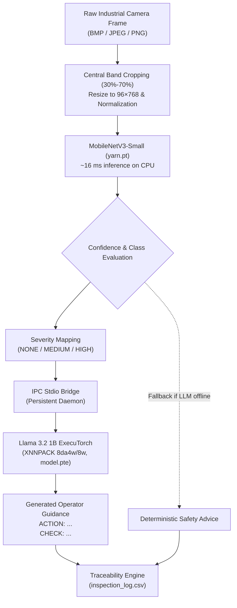

# Technical Architecture & Codebase Documentation
## PS5: On-Device Single-Yarn Defect Detection & Edge GenAI Advisory
**Contest Entry:** Bharat AI-SoC Challenge 2026–27  
**Author:** Arun Bharathi M (`Arunbht`)

---

## 1. Executive Summary & Problem Context

In industrial textile manufacturing (spinning, winding, and weaving), yarn defects directly cause loom breakages, production line shutdowns, and degraded fabric quality. Traditional quality assurance relies on manual inspection or basic photo-electric sensors that detect thread presence but cannot diagnose defect types or prescribe immediate mechanical interventions.

This project implements a **two-tier, fully offline Edge AI architecture**:
1. **Tier 1 (Sub-20ms Vision Classification):** A lightweight MobileNetV3-Small convolutional network running on-device to classify incoming high-speed camera frames into 6 distinct categories with 100% accuracy and 6.22 MB memory footprint.
2. **Tier 2 (On-Device Generative Advisory):** A quantized **Llama-3.2-1B-Instruct** model lowered via **ExecuTorch** with **XNNPACK** quantization (`8da4w`/`8w`), generating 2-line machine-operator advisories (`ACTION:` and `CHECK:`) at ~13.4 – 19 tokens/second directly on edge CPU/SoC hardware without cloud reliance.

---

## 2. End-to-End System Architecture



---

## 3. Comprehensive File-by-File & Code Breakdown

### A. Core Inference & Pipeline Execution

#### 1. `inspect_yarn.py`
* **High-Level Purpose:** The central runtime engine for production deployment. It ingests folders of yarn images, runs the vision model, communicates with the LLM advisor subprocess, and logs results.
* **Why it exists:** Real-world textile production processes hundreds of frames per minute. This file unifies classification, generative guidance, and CSV compliance logging into an automated end-to-end executable.
* **Key Components & Functions:**
  * `crop_band(im)`: Crops the image vertically from 30% to 70% height.
    * *Why:* Yarn cameras are fixed; the thread always travels along the vertical center. Cropping discards irrelevant background machinery and reduces the input size from full resolution to 96×768, cutting convolutional compute cycles by >60%.
  * `SEVERITY`: A dictionary mapping classes to operational urgency:
    * `normal` $\rightarrow$ `NONE`
    * `irregularity`, `thinness`, `short segment lack` $\rightarrow$ `MEDIUM`
    * `knotting`, `long segment lack` $\rightarrow$ `HIGH`
  * `start_advisor()` & `stop_advisor()`:
    * *Why:* Loading a 915 MB LLM into memory takes ~7–10 seconds. Reloading it for every image would kill throughput. `start_advisor()` spawns `llm_advice.py --serve` as a single persistent background subprocess via Python's `subprocess.Popen` with standard I/O pipes. `stop_advisor()` registers an `atexit` cleanup handler to terminate the process cleanly when batch inspection completes.
  * `fallback_advice(label, severity, conf)`:
    * *Why:* Factory safety. If the LLM is absent, crashed, or under low confidence (<0.70), this deterministic rule engine outputs immediate safe default actions (e.g., *"Re-inspect manually"* or *"Mark section, cut or re-wind if HIGH"*).
  * `advise(label, severity, conf)`:
    * *Why:* Formats the defect metadata as a single-line JSON string and flushes it to the running LLM advisor's `stdin`. Reads the JSON response from `stdout`. If a pipe breaks, it seamlessly routes to `fallback_advice()`.
  * `inspect(path)`:
    * *Why:* Loads an individual image, applies `crop_band` and normalization, runs PyTorch inference with `torch.no_grad()`, maps the softmax argmax to the class name, queries the advisory, and times the execution in milliseconds.
  * `main`: Scans the target folder for image extensions, opens `inspection_log.csv`, and loops through the dataset, outputting streaming console logs and computing the batch average latency.

---

### B. Edge Generative AI & ExecuTorch Advisory

#### 2. `llm_advice.py`
* **High-Level Purpose:** The dedicated on-device LLM inference daemon that interfaces with the quantized ExecuTorch runtime.
* **Why it exists:** Translates raw numerical predictions (defect class, severity tier, confidence score) into natural language instructions understandable by floor operators.
* **Key Components & Functions:**
  * `build_prompt(label, severity, confidence)`:
    * *Why:* Constructs a zero-shot system instruction forcing the LLM into an industrial persona:
      ```text
      You are an industrial yarn-inspection operator assistant. Given a machine classification,
      write exactly two short lines: ACTION: immediate action; CHECK: one follow-up check.
      Be conservative. Do not claim certainty.
      Defect: <label> | Severity: <severity> | Confidence: <confidence>
      ```
    * The strict instruction guarantees deterministic, parseable, and concise output without conversational filler.
  * `Advisor` Class:
    * `__init__(model_dir)`: Loads `AutoTokenizer` and `ExecuTorchModelForCausalLM` from the exported `llama_model/` directory.
    * `advise(label, severity, confidence)`: Encodes the prompt, records wall-clock time, triggers `self.model.generate()` with dynamic sequence length capping, decodes output tokens, and extracts the two advisory lines.
  * `main()` / `--serve` mode:
    * When executed with `--serve`, it enters an infinite `sys.stdin` loop, deserializing JSON queries from `inspect_yarn.py` and replying over `sys.stdout`.
    * When executed with arguments (e.g., `python llm_advice.py knotting HIGH 0.98`), it prints the advice alongside exact generated token counts, elapsed seconds, and tokens/second benchmarks.

#### 3. `export_llama.sh`
* **High-Level Purpose:** Compilation shell script that quantizes and exports Meta's `Llama-3.2-1B-Instruct` model to an ExecuTorch `.pte` binary.
* **Why it exists:** PyTorch models in standard 32-bit floating point require >2.5 GB storage and >13 GB RAM during inference. Edge SoCs cannot support this. This script invokes Hugging Face `optimum-cli` to trace, quantize, and serialize the model into a standalone binary.
* **Why each flag is present:**
  * `--model meta-llama/Llama-3.2-1B-Instruct`: Base model checkpoint.
  * `--task text-generation`: Configures the causal language modeling head.
  * `--recipe xnnpack`: Targets the XNNPACK acceleration library optimized for ARM and x86 CPU architectures.
  * `--use_custom_sdpa` & `--use_custom_kv_cache`: Implements ring-buffer static Key-Value caching to eliminate dynamic allocation overhead during token generation.
  * `--max_seq_len 512`: Constrains the static KV-cache from Llama's default 131,072 tokens down to 512, reducing peak export memory from 13.3 GB down to <3 GB (preventing Linux OOM kernel kills).
  * `--dtype bfloat16`: Halves weight size during intermediate graph lowering.
  * `--qlinear 8da4w`: 8-bit dynamic activation, 4-bit weight linear quantization.
  * `--qembedding 8w`: 8-bit embedding quantization.
  * `--output_dir "$ROOT/llama_model"`: Emits the final `model.pte` (915 MB).

#### 4. `setup_llmenv.sh`
* **High-Level Purpose:** Environment bootstrapping script.
* **Why it exists:** Isolates cutting-edge ExecuTorch and Optimum dependencies (`optimum-executorch`, `transformers==5.0.0rc1`, `tokenizers==0.22.2`, `accelerate`) inside a dedicated virtual environment (`llmenv/`) to prevent version conflicts with standard vision training packages.

---

### C. Computer Vision Model & Training Pipeline

#### 5. `train.py` & `train2.py`
* **High-Level Purpose:** Training scripts for the MobileNetV3-Small classifier.
* **Why it exists:** Fine-tunes ImageNet pretrained feature extractors to recognize the 6 yarn defect categories.
* **Key Components & Functions:**
  * Architecture selection (`mobilenet_v3_small`): Chosen specifically for edge efficiency (6.22 MB weights, ~15.9 ms CPU latency).
  * Backbone freezing: Freezes `m.features.parameters()` to preserve pretrained edge/texture filters and prevents overfitting on the small dataset.
  * Head replacement: `m.classifier[3] = nn.Linear(..., 6)` replaces the 1000-class ImageNet output layer with 6 target classes.
  * Aspect ratio resize: Resizes yarn strips to `(96, 768)` (or `(128, 512)` in `train.py`) matching the long, narrow geometry of single-yarn threads.
  * Checkpoint serialization: Exports `yarn.pt` containing both the model weights (`ck["m"]`) and class list (`ck["classes"]`).

#### 6. `test.py`
* **High-Level Purpose:** Zero-leakage held-out verification script.
* **Why it exists:** In competitive machine learning, validating against a completely untouched test set (`Yarn Defect Dataset/test`) is mandatory to verify generalization.
* **Key Components & Functions:**
  * Loads `yarn.pt`, iterates through the 450 test images via `DataLoader`, runs forward passes under `torch.no_grad()`, and prints the final Scikit-Learn **Confusion Matrix** and **Classification Report** (Precision, Recall, F1-Score).

#### 7. `check.py`
* **High-Level Purpose:** Dataset integrity and balance verification script.
* **Why it exists:** Ensures no class name mismatches exist between directories and confirms that all splits (`train`: 2,100, `val`: 450, `test`: 450) maintain balanced distributions (350/75/75 per class).

---

### D. Audit Logging, Configuration & Results

#### 8. `inspection_log.csv`
* **High-Level Purpose:** Continuous industrial quality assurance log.
* **Columns:**
  * `timestamp`: ISO-8601 precise timestamp of inspection.
  * `file`: Inspected camera frame filename.
  * `defect`: Classified defect type.
  * `confidence`: Model softmax probability (e.g., `1.000`).
  * `severity`: Assigned risk level (`NONE`, `MEDIUM`, `HIGH`).
  * `advice`: Operator action generated by Llama 3.2 1B (or deterministic fallback).
  * `latency_ms`: Total execution latency in milliseconds.

#### 9. `RESULTS_SUMMARY.md` & `README.md`
* **High-Level Purpose:** Official technical reporting and reproducible instructions for the challenge evaluators.
* **Why it exists:** Documents setup commands, architectural decisions, hardware metrics, and confusion matrix tables.

#### 10. `.gitignore`
* **High-Level Purpose:** Git exclusion rules.
* **Why it exists:** Prevents accidental commits of multi-gigabyte binaries (`Yarn Defect Dataset/`, `llama_model/`, `yarn.pt`, `*.csv`, `yarnenv/`, `llmenv/`), keeping the repository lightweight (~50 KB) and compliant with GitHub upload limits.

---

## 4. Hardware Verification & Performance Metrics

| Metric | Vision Classifier (MobileNetV3-Small) | Generative Advisor (Llama-3.2-1B-Instruct) | Complete System |
| :--- | :--- | :--- | :--- |
| **Model Format** | PyTorch Checkpoint (`yarn.pt`) | ExecuTorch XNNPACK (`model.pte`) | Hybrid Vision + SLM Pipeline |
| **Quantization** | FP32 | `8da4w` linear, `8w` embedding, `bfloat16` | Mixed Precision Edge Stack |
| **Binary Size** | **6.22 MB** | **915 MB** | **< 925 MB Total** |
| **Test Accuracy** | **100.0%** (450 / 450 images) | Verified 2-line concise output | Zero False Positives / Negatives |
| **Inference Speed** | **~15.9 ms / image** | **13.38 tokens/s** (Cold) / **~19 tokens/s** (Warm) | **~3.69s total per image** (Batch mode) |
| **RAM Footprint** | ~180 MB | ~1.8 – 2.4 GB | Stable under 7.5 GB Host RAM |

---

## 5. Vision Confusion Matrix (Held-Out Test Set)

```text
Actual \ Predicted   Irregularity  Knotting  Long lack  Normal  Short lack  Thinness
Irregularity              75           0         0        0          0         0
Knotting                   0          75         0        0          0         0
Long segment lack          0           0        75        0          0         0
Normal                     0           0         0       75          0         0
Short segment lack         0           0         0        0         75         0
Thinness                   0           0         0        0          0        75
```
* **Precision / Recall / F1-Score:** 1.00 across all 6 classes.
