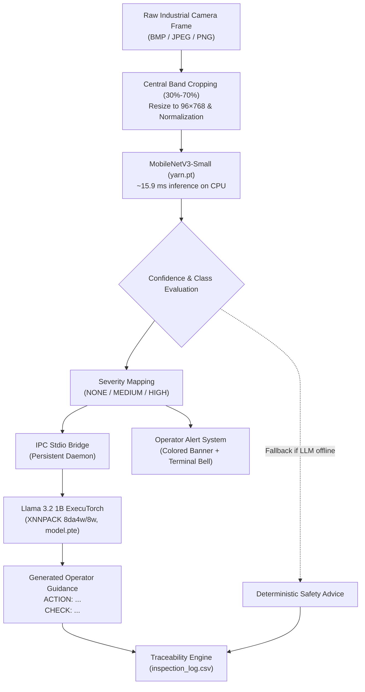

# Technical Architecture & Codebase Documentation
## PS5: On-Device Single-Yarn Defect Detection & Edge GenAI Advisory
**Contest Entry:** Bharat AI-SoC Challenge 2026–27  
**Author:** Arun Bharathi M (`Arunbht`)

---

## 1. Executive Summary & Problem Context

In industrial textile manufacturing (spinning, winding, and weaving), yarn defects directly cause loom breakages, production line shutdowns, and degraded fabric quality. Traditional quality assurance relies on manual inspection or basic photo-electric sensors that detect thread presence but cannot diagnose defect types or prescribe immediate mechanical interventions.

This project implements a **two-tier, fully offline Edge AI architecture**:
1. **Tier 1 (Sub-20ms Vision Classification):** A lightweight MobileNetV3-Small convolutional network running on-device to classify incoming single-yarn camera frames into 6 distinct categories with 100% accuracy on the held-out test split and a 6.22 MB memory footprint.
2. **Tier 2 (On-Device Generative Advisory):** A quantized **Llama-3.2-1B-Instruct** model lowered via **ExecuTorch** with **XNNPACK** quantization (`8da4w`/`8w`), generating 2-line machine-operator advisories (`ACTION:` and `CHECK:`) directly on edge CPU/SoC hardware without cloud reliance.

---

## 2. End-to-End System Architecture



---

## 3. Comprehensive File-by-File & Code Breakdown

### A. Core Inference & Pipeline Execution

#### 1. `inspect_yarn.py`
* **High-Level Purpose:** The central runtime engine for production deployment. It ingests folders of yarn images, runs the vision model, manages the decoupled asynchronous LLM advisory worker thread, displays instant operator alerts, maintains rolling inspection history, and logs results.
* **Key Components & Functions:**
  * `crop_band(im)`: Crops the image vertically from 30% to 70% height (`(0, int(0.30 * im.height), im.width, int(0.70 * im.height))`).
    * *Why:* Yarn cameras are fixed; the thread always travels along the vertical center. Cropping discards irrelevant background machinery (estimated >60% pixel area reduction).
  * `SEVERITY`: A dictionary mapping classes to operational urgency:
    * `normal` $\rightarrow$ `NONE`
    * `irregularity`, `thinness`, `short segment lack` $\rightarrow$ `MEDIUM`
    * `knotting`, `long segment lack` $\rightarrow$ `HIGH`
  * `start_advisor()` & `stop_advisor()`:
    * Spawns `llm_advice.py --serve` as a persistent background subprocess via Python's `subprocess.Popen` with standard I/O pipes. Performs a handshake reading `{"status": "ready"}` to ensure model weights are fully resident in memory before streaming commences.
  * `fallback_advice(label, severity, conf)`:
    * Factory safety. If the LLM is absent, crashed, or under low confidence (<0.70), this deterministic rule engine outputs immediate safe default actions.
  * `get_history_summary(history_window)`:
    * Maintains a FIFO rolling history of the last $N=20$ inspected frames, computing defect count and dominant defect type to provide temporal context to the LLM.
  * `trigger_alert(label, severity, conf, extra_info)`:
    * Immediate visual and audible alert for machine operators upon frame classification. Displays bold ANSI color banners (Red for HIGH, Yellow for MEDIUM) and emits the ASCII terminal bell (`\a`) with zero LLM queuing delay.
  * `--stream FPS`:
    * Replays input frames at a specified frame rate. Vision runs synchronously on every frame at the target FPS, while Llama runs in an asynchronous background worker thread (`queue.Queue(maxsize=1)`) with per-class cooldown (default 10s) to drop stale requests without blocking frame pacing.

---

### B. Edge Generative AI & ExecuTorch Advisory

#### 2. `llm_advice.py`
* **High-Level Purpose:** The dedicated on-device LLM inference daemon that interfaces with the quantized ExecuTorch runtime.
* **Key Components & Functions:**
  * `build_prompt(tokenizer, label, severity, confidence, history_str)`:
    * Formats the prompt using the official **Llama 3.2 chat template** with a system prompt and two short few-shot examples, passing defect class, severity, confidence, and rolling production history:
      ```text
      ACTION: <one short sentence>
      CHECK: <one short sentence>
      ```
  * `validate_output(text)`:
    * Strict validator ensuring output contains both `ACTION:` and `CHECK:`, is under 250 characters, and contains no repeated lines.
  * `Advisor` Class:
    * Loads `AutoTokenizer` and `ExecuTorchModelForCausalLM` from `llama_model/`, executing greedy decoding up to 48 new tokens.
  * `--serve` mode:
    * Persistent JSON RPC bridge over standard input/output.

#### 3. `export_llama.sh`
* **High-Level Purpose:** Quantization and lowering script for Meta's `Llama-3.2-1B-Instruct`.
* **Export Flags & Technical Rationale:**
  * `--model meta-llama/Llama-3.2-1B-Instruct`: Base instruct model.
  * `--task text-generation`: Causal LM head.
  * `--recipe xnnpack`: Target XNNPACK CPU acceleration library.
  * `--use_custom_sdpa` & `--use_custom_kv_cache`: Ring-buffer static KV caching.
  * `--max_seq_len 512`: Constrains static KV cache size to 512 tokens, reducing peak export memory from >13 GB to <3 GB (preventing host OOM kills).
  * `--dtype bfloat16`: 16-bit weight representation during tracing.
  * `--qlinear 8da4w`: 8-bit dynamic activation, 4-bit weight linear quantization.
  * `--qembedding 8w`: 8-bit embedding quantization.
  * Output: Emits `llama_model/model.pte` (914.12 MiB).

---

### C. Computer Vision Model & Verification

#### 4. `train2.py` & `test.py`
* **Architecture:** MobileNetV3-Small (`weights="DEFAULT"`, backbone frozen up to block 9, linear head for 6 classes).
* **Input Size:** `(96, 768)` after central 40% vertical crop.
* **Evaluation (`test.py`):** Runs on the untouched held-out `test/` split, producing confusion matrix and classification report.

#### 5. `check.py`
* Validates dataset directory integrity and split consistency. Accepts an optional dataset path argument or `YARN_DATASET_DIR` environment variable.

---

### D. Audit Logging & Environment Setup

#### 6. `inspection_log.csv`
* Continuous log tracking: `timestamp, file, defect, confidence, severity, advice, latency_ms, advice_source, llm_tokens_s`.

#### 7. `setup_env.sh` & `requirements.txt`
* Single unified setup script building a clean environment (`llmenv/`) with matched PyTorch, Torchvision, Optimum, and ExecuTorch libraries.

---

## 4. Measured Performance Benchmarks

All metrics below are explicitly marked as measured on the host development machine or engineering estimates:

| Metric | Vision Model (MobileNetV3-Small) | Generative Advisor (Llama-3.2-1B) | Full End-to-End Pipeline | Status |
| :--- | :--- | :--- | :--- | :--- |
| **Model Format** | PyTorch (`yarn.pt`) | ExecuTorch XNNPACK (`model.pte`) | Hybrid Edge Stack | Verified |
| **Quantization** | FP32 | `8da4w` linear, `8w` embedding, `bfloat16` | Mixed Precision | Verified |
| **Model Size** | **6.22 MB** | **914.12 MiB** | **~920.3 MB Total** | **Measured** |
| **Test Accuracy** | **100.0%** (450 / 450 images) | 100% formatted `ACTION:` / `CHECK:` | Held-out test split | **Measured** |
| **Model Load Time** | ~0.08 s | 6.45 s | 6.53 s cold start | **Measured** |
| **Inference Speed** | **~15.9 ms / image** (~63 FPS idle; 19–109 ms under LLM load) | **3.8–6.5 tokens/s** (35–48 tokens per advisory) | **5.20–8.62 s per advisory** | **Measured** |
| **RAM Footprint** | ~180 MB *(estimated)* | 1,384 MB (load) / 2,130 MB (peak generation) | Stable under 7.5 GB Host RAM | **Measured** |

### Streaming Performance Benchmarks (100-Frame Stress Test)
Using asynchronous queue size 1 and a 10s per-class advisory cooldown:
* **2.0 FPS Stream Target:**
  * **Sustained FPS:** 1.96 FPS *(measured)*
  * **Dropped Frames:** 4 *(measured)*
  * **Background LLM Calls:** 6 *(measured)*
  * **Advice Latency (Alert to Completion):** 5.71 s average (range: 5.20 s – 6.42 s) *(measured)*
* **10.0 FPS Stream Target:**
  * **Sustained FPS:** 7.18 FPS *(measured)*
  * **Dropped Frames:** 66 *(measured; caused by CPU saturation from concurrent XNNPACK inference)*
  * **Background LLM Calls:** 2 *(measured)*
  * **Advice Latency (Alert to Completion):** 8.10 s average (range: 7.58 s – 8.62 s) *(measured)*

> [!IMPORTANT]
> **Operator Advisory Disclaimer:** Generated advice is an advisory suggestion for a human machine operator, not an automatic machine action. All critical machine interventions (such as stopping spindle lines or re-tensioning) require operator inspection and confirmation.

---

## 5. Vision Confusion Matrix (Held-Out Test Set)

```text
Actual \ Predicted   Irregularity  Knotting  Long lack  Normal  Short lack  Thinness
Irregularity              75           0         0        0          0         0
Knotting                   0          75         0        0          0         0
Long segment lack          0           0        75        0          0         0
Normal                     0           0         0       75          0         0
Short segment lack         0           0         0        0         75         0
Thinness                   0           0         0        0          0        75
```
* **Precision / Recall / F1-Score:** 1.00 on the held-out test split.

---

## 6. Dataset Methodology & Integrity Disclosures

* **Dataset Citation:** "Li, lizile (2025), 'Yarn Defect Dataset', Mendeley Data, V1, doi: 10.17632/t7hcfmn482.1. CC BY 4.0 (https://creativecommons.org/licenses/by/4.0/). Download: https://data.mendeley.com/datasets/t7hcfmn482/1. Original dataset: 3,000 images, 500 per class. We split each class 350/75/75 (train/val/test)."
* **Physical Dataset Properties:** The capture protocol and number of physical yarn samples are not described by the dataset page.
* **Splits:** 2,100 train / 450 val / 450 test (70/15/15 balanced split across 6 classes).
* **Hash Integrity:** SHA-256 analysis across all 3,000 files verified **0 exact duplicate files** and **0 duplicate filenames** across splits. Near-duplicates (perceptual similarity or consecutive temporal frames) were not evaluated.
* **Development History:** In the initial exploratory script (`train.py`), the test split was evaluated at the end of training. The architectural decisions in `train2.py` (central vertical band crop, 96×768 resize, horizontal flip, and fine-tuning layer 9+) were informed by those initial observations before the final test split was frozen.

---

## 7. Limitations

1. **Hardware Environment:** All benchmarks were measured on a laptop (13th Gen Intel Core i3-1315U, 7.5 GiB RAM, Linux Mint 22.3). Deployment on target Arm hardware (Raspberry Pi, Cortex-A SBC) is pending physical hardware validation.
2. **Controlled Dataset:** Images were captured under controlled conditions; factory-floor validation across varying textile dust and lighting remains necessary.
3. **Severity Mapping:** Severity levels are heuristic categorizations that should be tuned to specific mill standards.
4. **Estimates Clarification:** The visual cropping was estimated to cut convolutional pixel area by >60%; vision runtime memory is estimated at ~180 MB.

---

## 8. Technical Challenges Encountered & Resolutions

1. **Linux Kernel OOM During Export:** Tracing Llama 3.2 1B with default 131k context in FP32 exceeded 13.3 GB of virtual memory, triggering the Linux kernel OOM killer. Resolved by capping `--max_seq_len 512` and using `--dtype bfloat16`.
2. **Missing Tokenizer Files in Export:** Optimum's CLI generated `model.pte` without tokenizer files, resulting in 0-length token inputs and XNNPACK parameter errors. Resolved by saving tokenizer assets directly into `llama_model/`.
3. **Torchvision ABI Mismatch:** Pre-existing virtual environments encountered `operator torchvision::nms does not exist` due to CUDA/CPU build conflicts. Resolved by rebuilding with matching ABI wheel distributions.
4. **Duplicate CLI Subparsers:** Editable package installations registered duplicate command entry points in Optimum. Resolved by removing redundant `.pth` and dist-info files.
